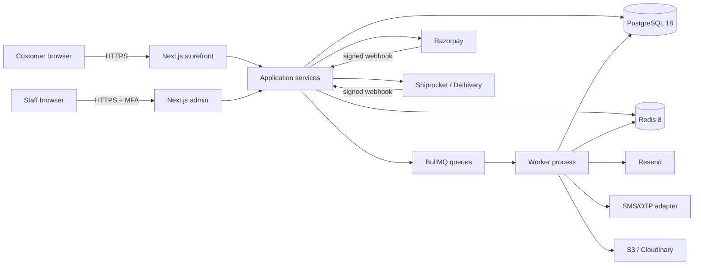
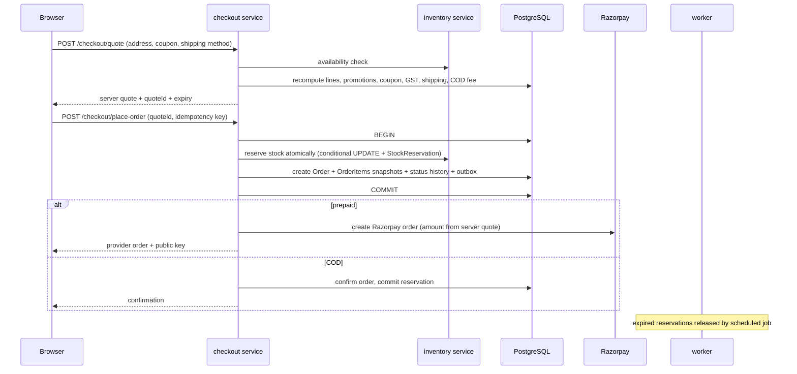
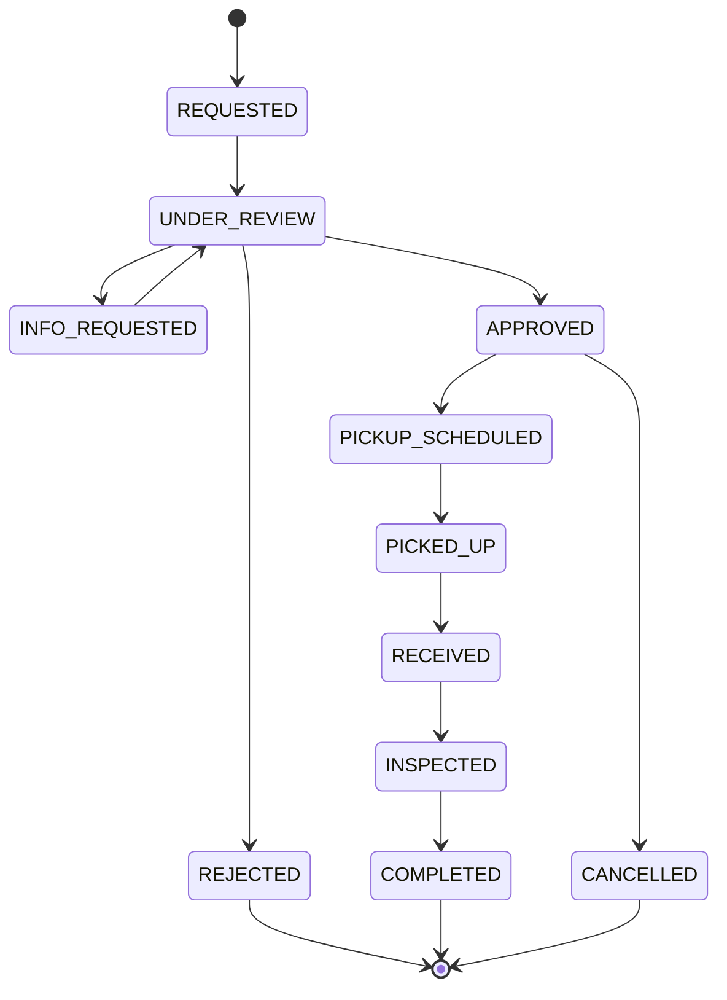
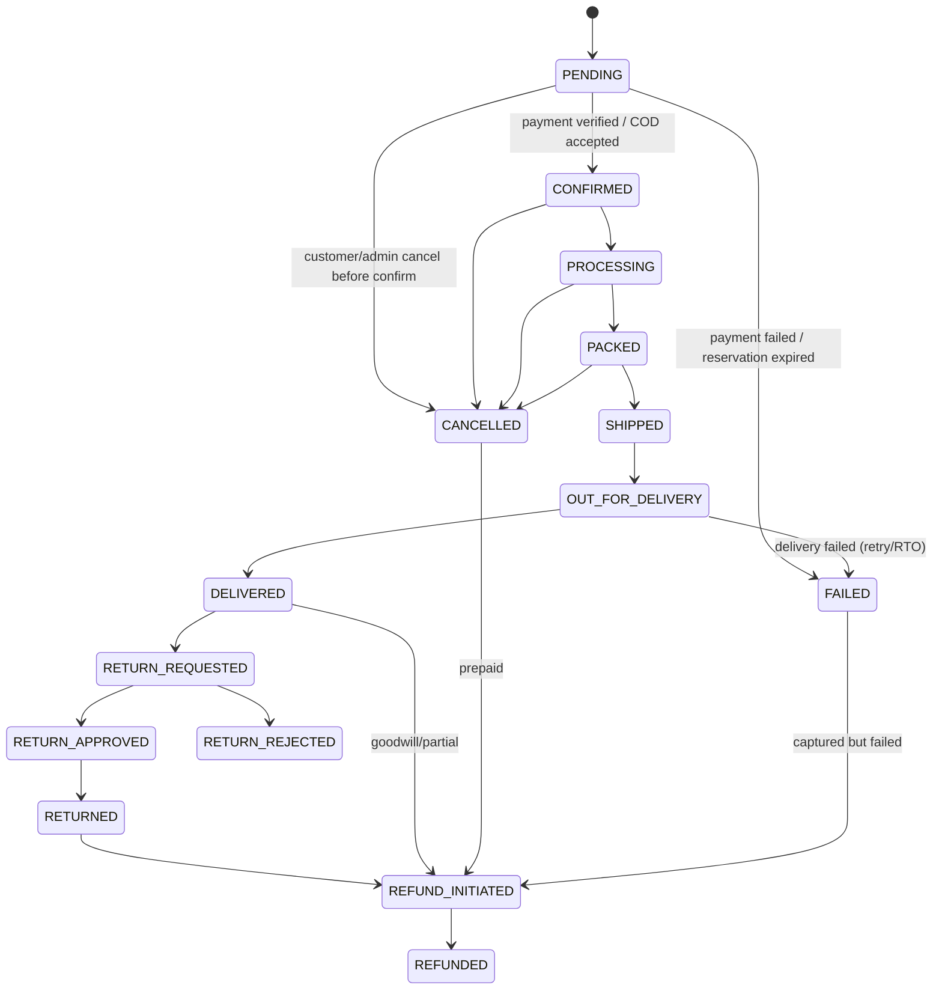

# Phase 1 — System Architecture

**Product:** CasaCircuit (working brand) — furniture and electronics retail, India.
**Model:** Single-seller inventory e-commerce entity.
**Style:** Modular monolith, Next.js 16 App Router + PostgreSQL 18 + Redis 8.

---

## 1. Context



Trust boundaries:

- Browser is untrusted. Prices, discounts, stock, roles and payment status from the client are never authoritative.
- Razorpay/shipping webhooks are untrusted until signature-verified and idempotently processed.
- The admin UI is not a security boundary; every admin operation is authorized server-side.
- The database is reachable only from the app/worker network. No browser access.
- Object storage is private; delivery uses signed URLs or a CDN with a controlled public prefix for product images.

---

## 2. Layering and dependency rule

```text
src/app/**            Presentation (RSC, client components, route handlers, server actions)
        │  may call
        ▼
src/modules/*/        Application + domain + repository for each bounded context
        │  may call
        ├── src/lib/**            Infrastructure (prisma, redis, auth, storage, mail, payments)
        └── src/modules/*/ports   Cross-module interfaces only
```

Hard rules:

1. A route handler/server action contains **no business rules**. It validates input, resolves the actor, calls a service, maps the result to HTTP.
2. A service never imports `next/*`, `react`, or UI components.
3. A repository is the only place that uses Prisma models for a module's own aggregates. Cross-module reads go through the other module's service/query interface.
4. Domain functions (pricing, tax, coupon eligibility, state transitions) are pure TypeScript with Decimal.js. They are unit-tested without a database.
5. All external integrations implement an interface in `src/lib/integrations/<kind>/provider.ts`. No vendor SDK leaks into business logic.

```
src/modules/<module>/
├── <module>.schema.ts       Zod input/output contracts
├── <module>.repository.ts   Prisma access, transactions
├── <module>.service.ts      Use cases, authorization hand-off, orchestration
├── <module>.domain.ts       Pure rules / state machines
├── <module>.types.ts        Domain types, no Prisma types
└── index.ts                 Public surface (what other modules may import)
```

---

## 3. Module map

| Module          | Owns                                                                  | Depends on (public interfaces)                                |
| --------------- | --------------------------------------------------------------------- | ------------------------------------------------------------- |
| `auth`          | Sessions, credentials, OTP, password reset, MFA                       | users, notifications                                          |
| `users`         | Customers, staff profiles, addresses, account deletion                | auth (types only), audit                                      |
| `rbac`          | Roles, permissions, grants                                            | users                                                         |
| `catalog`       | Categories, attributes, brands, products, variants, images, specs     | storage, search                                               |
| `inventory`     | Warehouses, stock, reservations, movements, POs, suppliers, transfers | catalog                                                       |
| `pricing`       | Price resolution, price history, promotions                           | catalog                                                       |
| `cart`          | Carts, items, guest merge                                             | catalog, pricing, coupons, inventory(read)                    |
| `coupons`       | Coupons, eligibility, redemption                                      | cart totals, orders                                           |
| `checkout`      | Quote calculation, address validation, order placement                | cart, pricing, coupons, inventory, shipping, payments, orders |
| `orders`        | Order lifecycle, snapshots, invoices, cancellations                   | inventory, payments, notifications                            |
| `payments`      | Razorpay orders, verification, webhooks, reconciliation, COD          | orders (state transitions), notifications                     |
| `refunds`       | Refund initiation, provider refunds, ledger                           | payments, orders                                              |
| `returns`       | Return requests, eligibility, inspection, replacement                 | orders, inventory, refunds, shipping                          |
| `shipping`      | Serviceability, rates, labels, tracking, furniture delivery           | orders, inventory                                             |
| `reviews`       | Reviews, images, moderation, Q&A                                      | orders (verified purchase), catalog                           |
| `notifications` | Templates, email/SMS/WhatsApp queues, logs, dedupe                    | —                                                             |
| `support`       | Tickets, messages, SLA                                                | users, orders, notifications                                  |
| `legal`         | Documents, versions, consent, privacy requests, grievances, audits    | users, audit                                                  |
| `cms`           | Banners, pages, blogs, FAQs, navigation, stores                       | storage                                                       |
| `analytics`     | Dashboards, reports, exports                                          | orders, payments, inventory, catalog                          |
| `audit`         | Append-only audit log, security events                                | —                                                             |
| `search`        | Query parsing, ranking, suggestions                                   | catalog read model                                            |
| `settings`      | Business profile, tax config, feature flags, policy values            | —                                                             |

No module writes another module's tables. Cross-aggregate workflows use an orchestrating service (e.g. `checkout.placeOrder`) and, where asynchronous, the outbox.

---

## 4. Actual folder structure

```text
.
├── docs/                          Architecture, research, runbooks, ADRs
├── prisma/
│   ├── schema.prisma
│   ├── migrations/
│   └── seed.ts
├── public/
├── src/
│   ├── app/
│   │   ├── (storefront)/          Home, products, categories, cart, checkout,
│   │   │                          account, orders, wishlist, compare, policies
│   │   ├── admin/                 Dashboard, catalog, inventory, orders, payments,
│   │   │                          refunds, returns, shipping, coupons, reviews,
│   │   │                          reports, support, staff, settings, legal, cms
│   │   ├── api/v1/                REST: public, account, admin, webhooks, health
│   │   ├── layout.tsx
│   │   ├── robots.ts
│   │   └── sitemap.ts
│   ├── components/
│   │   ├── ui/                    shadcn-style primitives
│   │   ├── storefront/ product/ cart/ checkout/ admin/
│   ├── modules/                   Bounded contexts (see module map)
│   ├── lib/
│   │   ├── prisma.ts  redis.ts  auth/  security/  money/  validation/
│   │   ├── integrations/          payment/ shipping/ storage/ email/ sms/
│   │   ├── constants/ utils/ logger.ts
│   ├── jobs/                      BullMQ queue definitions + processors
│   ├── emails/                    React Email templates
│   ├── hooks/  types/
│   ├── worker.ts                  Separate worker entrypoint
│   └── proxy.ts                   Security headers, CSP nonce, admin gate
├── tests/{unit,integration,e2e,security,load}/
├── docker/  Dockerfile  docker-compose.yml
├── .github/workflows/
├── prisma.config.ts
├── next.config.ts  tsconfig.json  package.json
└── .env.example
```

---

## 5. Key request flows

### 5.1 Browse and search

```mermaid
sequenceDiagram
  participant B as Browser
  participant R as RSC / route handler
  participant S as catalog/search service
  participant C as Redis cache
  participant D as PostgreSQL
  B->>R: GET /products?category=sofas&sort=price_asc&page=1
  R->>S: listProducts(query, actor)
  S->>C: get(key)
  alt cache hit
    C-->>S: page payload
  else miss
    S->>D: filtered, paginated query (indexes; FTS/trigram)
    D-->>S: rows
    S->>C: set(key, ttl 60s)
  end
  S-->>R: page + facets + price history
  R-->>B: HTML (RSC) with SEO metadata and JSON-LD
```

Cache keys include category path, filter hash, sort, page, and a catalog version counter bumped on publish. Price/stock display is short-TTL cached; checkout always revalidates from the database.

### 5.2 Add to cart

1. Client posts variant ID + quantity to a Server Action or `POST /api/v1/cart/items`.
2. Zod validates shape; quantity bounded (1–10 per line, configurable).
3. Cart service resolves the active cart (user or guest cookie hash).
4. Repository upserts the line, then the pricing service recomputes the cart from database prices and active promotions.
5. Coupon is revalidated; if it no longer qualifies it is removed with a machine-readable reason.
6. Stock is **not** reserved at add-to-cart. Availability is shown, but reservation happens at checkout.
7. Response returns recomputed totals and a cart version. The client never sends totals.

### 5.3 Checkout and inventory reservation



Reservation TTL default 15 minutes (configurable). A conditional SQL update guarantees `onHand - reserved - damaged >= requested`; if any line fails, the whole transaction rolls back and the customer sees an out-of-stock line. This is the overselling barrier.

### 5.4 Payment webhook

1. Read the **raw** body; verify `X-Razorpay-Signature` HMAC with the webhook secret.
2. Reject stale timestamps; insert `WebhookEvent(provider, eventId)` with a unique constraint. Duplicate event IDs return 200 without side effects.
3. Fetch the payment/order from Razorpay server-side; compare amount, currency and receipt/order reference with the local order.
4. In one transaction: update `Payment`, append `PaymentTransaction`, transition the order (`PENDING → CONFIRMED`), commit reserved stock, write outbox events.
5. Enqueue confirmation email/SMS and invoice generation.
6. A scheduled reconciler re-queries pending payments older than N minutes and settles/releases them. The browser's "success" callback is only a UX hint; it can never mark an order paid.

### 5.5 Return → refund



Eligibility is evaluated server-side from the order item snapshot, delivery date, category policy, product condition, and legal minimums. The policy snapshot is stored on the return request so later policy changes do not rewrite history. Refunds go through `refunds` and are only marked `COMPLETED` on a verified provider refund (or recorded manual bank transfer with an auditable reference).

---

## 6. Order state machine



Rules are encoded as a single transition table with allowed actors and required permissions. Every transition appends `OrderStatusHistory` with actor, reason and metadata. Financial transitions require a verified payment/refund record. Partial cancellation and partial refund are item-level quantities, not free-text status changes.

---

## 7. Pricing, discount and GST engine

All money is `Decimal` (never `number` for arithmetic). Currency INR.

Order of operations for a cart:

1. Resolve effective variant price (tax-inclusive) from catalog + active promotions.
2. Line subtotal = unit price × quantity.
3. Allocate promotion discount per line (largest-remainder to avoid paise drift).
4. Validate coupon against eligible subtotal (scope: order/category/brand/product), min cart value, first-order, dates, global and per-customer limits.
5. Apply coupon discount, allocated pro-rata across eligible lines using largest-remainder.
6. Discounted line total is still tax-inclusive. Extract tax per line: `taxable = total / (1 + rate)`, `tax = total - taxable`, rounded to 2 decimals. Split into CGST/SGST (intra-state) or IGST (inter-state) from place of supply vs seller state.
7. Add shipping and COD fee (fees have their own GST treatment configured; shipping GST is stored explicitly).
8. Grand total = sum of discounted line totals + shipping + COD fee.
9. Persist the computed quote with a hash of inputs. At order placement, recompute and compare; if the hash changed (price/stock/coupon), reject with `QUOTE_STALE`.

Rounding: half-up to 2 decimals per line; a single invoice-level round-off line reconciles to the nearest rupee if the operator enables it. The invoice always prints the exact tax breakup.

Coupon concurrency: `Coupon.usedCount` is incremented with a conditional atomic update inside the order transaction; a unique `CouponUsage(orderId)` prevents double redemption. Per-customer limits are enforced by a count query inside the same transaction under a row lock on the coupon (or serializable retry). This is tested with concurrent redemption tests.

GST configuration is data, not code: GST rate per product/HSN, seller state, shipping tax rate, COD fee tax rate. A rate change creates a new price/tax history row; existing orders keep snapshots.

---

## 8. Inventory model

- Stock is per `ProductVariant × Warehouse`.
- Columns: `onHand`, `reserved`, `damaged`, `returned`, `lowStockThreshold`.
- Sellable = `onHand - reserved - damaged`.
- Reservations are rows (`StockReservation`) linked to a cart/order, with `expiresAt` and status. The atomic decrement is implemented as a conditional raw `UPDATE ... WHERE on_hand - reserved - damaged >= $qty RETURNING ...`; never read-then-write.
- On payment success: `onHand -= qty`, `reserved -= qty`, write `SALE_FULFILLED` movement.
- On reservation expiry/cancel: `reserved -= qty`, write `SALE_RELEASED`.
- Returns: inspected resalable units increment `onHand` (or `returned` then `onHand` after QC); damaged units increment `damaged` and never become sellable.
- Every change writes an append-only `StockMovement` with actor, reference and reason. Manual adjustments require `inventory.adjust`.
- Purchase orders, goods receipts, supplier records and warehouse transfers use the same ledger; there is no direct "set stock" endpoint without a movement.
- Low-stock alerts are emitted as outbox events when sellable crosses the threshold.

---

## 9. Authentication and authorization

- Opaque 256-bit session token, stored only as SHA-256 hash. Cookie: `__Host-cc_session` in production (Secure, HttpOnly, SameSite=Lax, Path=/), a dev variant on localhost.
- Idle and absolute timeouts differ for customers vs staff. Rotation on login, password change, privilege change, and periodically.
- CSRF: Server Actions rely on Next.js Origin/Host checks; API mutations additionally require `X-CSRF-Token` bound to the session. Webhooks are exempt but signature-verified.
- Argon2id parameters: 64 MiB memory, 3 iterations, parallelism 1; rehash on login if parameters change.
- OTP: 6 digits, 5-minute expiry, max 5 attempts, hashed at rest, per-phone and per-IP rate limits.
- Admin MFA: TOTP, encrypted secret (AES-256-GCM with `MFA_ENCRYPTION_KEY`), recovery codes hashed.
- RBAC: permissions are strings (`products.update`, `refunds.approve`, ...). Roles are seeded but editable. `requirePermission(actor, 'refunds.approve')` runs in the service, not only in the UI. Ownership checks (`assertOwnsOrder`) prevent IDOR.
- Every sensitive action writes an `AuditLog` with actor, IP, request ID, before/after (redacted).

---

## 10. Asynchronous work and reliability

Queues (BullMQ, Redis):

| Queue           | Jobs                                                                    |
| --------------- | ----------------------------------------------------------------------- |
| `notifications` | email, SMS, WhatsApp, in-app; retries with exponential backoff + jitter |
| `inventory`     | release expired reservations, low-stock alerts                          |
| `orders`        | invoice PDF, status notifications, stale-payment reconciliation         |
| `payments`      | reconciliation, refund status polling                                   |
| `returns`       | pickup reminders, inspection SLA                                        |
| `reports`       | large CSV/Excel exports                                                 |
| `legal`         | retention/erasure scheduler, SLA reminders                              |
| `media`         | image re-encode, EXIF strip, malware scan                               |

Reliability pattern: **transactional outbox**. Business transactions insert `OutboxEvent`; a dispatcher claims rows with `FOR UPDATE SKIP LOCKED`, enqueues, and marks dispatched. Jobs are idempotent by `dedupeKey`. Email/SMS logs record attempts and provider message IDs. BullMQ uses a separate worker container, graceful shutdown, and a dead-letter review path.

---

## 11. Caching and search

- Redis namespaces: `catalog:v{n}:...`, `session:...` (sessions are DB-backed; Redis only caches), `ratelimit:...`, `lock:...`, `ship:pin:...`.
- Catalog TTL 60s, categories/navigation 5 min, product detail 30s, serviceability 24h. Invalidation via a catalog version counter.
- Cart, checkout, stock and admin data are never served from cache as authority.
- Search starts on PostgreSQL: `tsvector` GIN index over name/description/keywords + `pg_trgm` for typo tolerance, with a ranking function that is explainable (text match, sales, rating, recency). Sponsored placements are a separate, labelled field and never silently reorder organic results.
- The `SearchProvider` interface allows Meilisearch/Typesense/Elasticsearch later without changing callers.

---

## 12. Security architecture (summary; see 05-SECURITY.md)

- OWASP Top 10 / ASVS aligned controls.
- CSP with per-request nonce, strict transport security, frame-ancestors none, no sniff, referrer policy, permissions policy.
- Zod at every boundary; Prisma parameterization; raw SQL only with bound parameters.
- Rate limiting via Redis sliding window per IP + per identity + per route class.
- Uploads: presigned, content-type/size constrained, re-encoded, EXIF stripped, malware scan before public availability.
- SSRF: no arbitrary server-side URL fetch; outbound hosts allowlisted.
- Payment: signature verification, amount/currency checks, idempotency, reconciliation.
- Errors: no stack traces or SQL in production responses; correlation ID only.
- Logs: structured, redacted, 180-day retention in India; security events separated.
- Backups encrypted; restore drills; least-privilege DB roles.

---

## 13. Deployment topology

```text
                 ┌──────────────┐
   Internet ───▶ │ CDN / WAF    │
                 └──────┬───────┘
                        │
              ┌─────────▼─────────┐
              │ Next.js web (2+)  │  stateless
              └────┬─────────┬────┘
                   │         │
        ┌──────────▼──┐  ┌───▼────────┐
        │ PostgreSQL  │  │ Redis      │
        │ primary+RR  │  │ (managed)  │
        └──────────▲──┘  └───▲────────┘
                   │         │
              ┌────┴─────────┴────┐
              │ Worker (1+)       │
              └───────────────────┘
```

- Web and worker are separate containers/processes from the same image.
- Migrations run as a release step with a dedicated migration role, never automatically on app boot in production.
- Health: `/api/v1/health/live` (process), `/api/v1/health/ready` (DB + Redis).
- Graceful shutdown drains HTTP and closes BullMQ workers.
- Config via env/secret manager; no secrets in the image or database settings.

---

## 14. Architecture decision records

ADRs live in `docs/adr/`. Initial set:

- ADR-001 Modular monolith
- ADR-002 Server sessions vs JWT
- ADR-003 Tax-inclusive pricing and GST extraction
- ADR-004 Inventory reservation strategy
- ADR-005 Outbox instead of dual writes
- ADR-006 Razorpay webhook as payment source of truth
- ADR-007 Price history for prior-price compliance
- ADR-008 Search adapter
- ADR-009 Legal content versioning
- ADR-010 Single-seller v1, marketplace seam only

The table in `01-RESEARCH.md` §4 is the summary; each ADR expands context, alternatives, consequences and review date.
