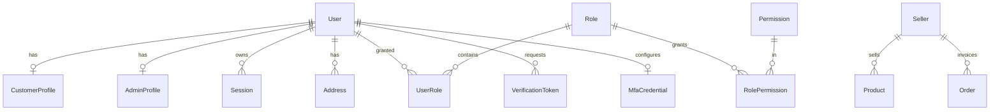
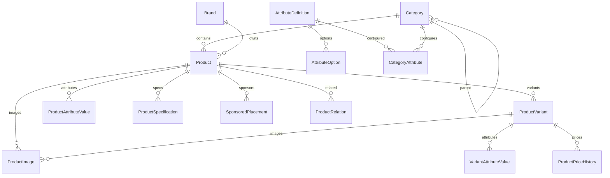
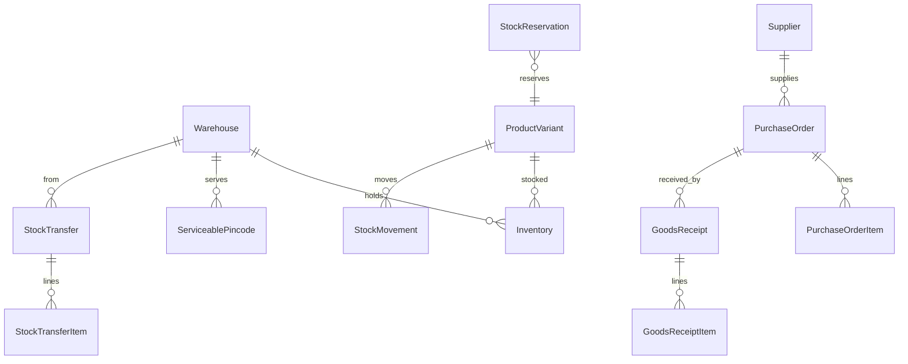
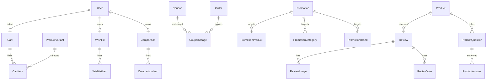
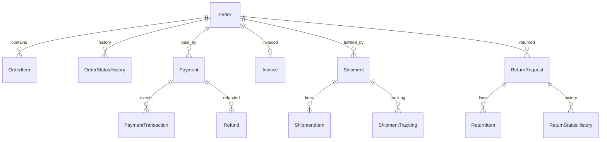

# Phase 1 — Database Design

**Database:** PostgreSQL 18
**ORM:** Prisma 7.10.1 (`prisma-client` generator, driver adapter `@prisma/adapter-pg`)
**Authoritative schema:** `prisma/schema.prisma` (this document explains intent; the schema is the source of truth)

---

## 1. Conventions

| Concern      | Rule                                                                                                                      |
| ------------ | ------------------------------------------------------------------------------------------------------------------------- |
| Primary keys | `String @id @default(cuid())` everywhere                                                                                  |
| Money        | `Decimal @db.Decimal(14,2)`; currency code `CHAR(3)` default `INR`                                                        |
| Tax rates    | `Decimal @db.Decimal(5,2)` (e.g. `18.00`)                                                                                 |
| Quantities   | `Int`, constrained `>= 0` in SQL where appropriate                                                                        |
| Timestamps   | `DateTime @db.Timestamptz(3)`; UTC in DB, IST in display                                                                  |
| Soft delete  | Only `User.deletedAt`, `Product.archivedAt`, `Category.archivedAt`, `Address.deletedAt` — never for orders/payments/audit |
| PII          | Normalised/validated at the service boundary; encrypted at rest by the database/volume; MFA secrets application-encrypted |
| History      | Orders, invoices, payments, refunds and stock movements are append-only; corrections are new records                      |
| Enums        | PostgreSQL enums for finite state machines                                                                                |
| JSON         | Only for snapshots, provider payloads, flexible config; never for query-critical fields                                   |
| Search       | `tsvector` column + GIN index added by raw migration; `pg_trgm` for typo tolerance                                        |

Every table has `createdAt`; mutable tables also have `updatedAt`.

---

## 2. Domain groups

### 2.1 Identity, access and legal seller



- `User`: email (unique, nullable), phone (unique, nullable), passwordHash (nullable for OTP-only), status, emailVerifiedAt, phoneVerifiedAt, firstName, lastName, marketingOptIn, lastLoginAt, deletedAt. At least one of email/phone is required by a service invariant.
- `CustomerProfile`: dateOfBirth, gender (optional), preferredLanguage, loyalty fields, riskFlags.
- `AdminProfile`: employeeId, department, designation, isMfaRequired, lastPasswordChangeAt.
- `Seller`: legalName, displayName, entityType, gstin, pan, cin, registeredAddress Json, principalAddress Json, customerCareEmail/phone, grievanceOfficer fields, isPlatformOwner, status. **No seeded legal identity.**
- `Role` / `Permission` / `RolePermission` / `UserRole`: permission codes are strings; seeded roles are SUPER_ADMIN, ADMIN, PRODUCT_MANAGER, INVENTORY_MANAGER, ORDER_MANAGER, CUSTOMER_SUPPORT, FINANCE_MANAGER, CONTENT_MANAGER.
- `Session`: tokenHash (unique), userId, csrfTokenHash, ip, userAgent, lastSeenAt, expiresAt, revokedAt, rotatedFromId.
- `VerificationToken`: tokenHash (unique), type (EMAIL_VERIFY, PASSWORD_RESET, PHONE_OTP, LOGIN_OTP, STAFF_INVITE), userId/identifier, codeHash, attempts, maxAttempts, expiresAt, consumedAt, ip.
- `MfaCredential`: userId unique, secretEncrypted, backupCodesHashed Json, enabledAt, lastUsedAt.

### 2.2 Catalog



- `Category`: name, slug (unique), parentId, path (materialised, e.g. `/furniture/living-room/sofas`), level, description, imageUrl, icon, isActive, sortOrder, seoTitle, seoDescription, returnWindowDays, isReturnable, replacementAllowed, warrantyMonths, shippingClass.
- `Brand`: name, slug unique, logoUrl, description, isFeatured, seo fields, isActive.
- `Product`: name, slug unique, baseSku unique, categoryId, brandId, sellerId, shortDescription, description (sanitised HTML), status, publishedAt, archivedAt, hsnCode, gstRate, priceIncludesTax, countryOfOrigin, manufacturerName, manufacturerAddress, packerName, importerName, netQuantity, unitOfMeasure, unitSalePrice, warrantyMonths, warrantyType, isReturnable, returnWindowDays, replacementAllowed, assemblyRequired, installationRequired, isFragile, isHeavy, shippingClass, ratingAvg, ratingCount, reviewCount, soldCount, viewCount, metaTitle, metaDescription, searchKeywords, searchVector.
- `ProductVariant`: productId, sku unique, name, barcode, price, mrp, costPrice, taxRate (override), weightGrams, lengthMm, widthMm, heightMm, isDefault, isActive, position, imageId.
- `ProductImage`: productId, variantId nullable, url, alt, width, height, blurDataUrl, sortOrder, isPrimary.
- `AttributeDefinition`: code unique, name, dataType (TEXT, NUMBER, BOOLEAN, SELECT, MULTI_SELECT), unit, isVariantAxis, isFilterable, isComparable, sortOrder, isActive.
- `AttributeOption`: attributeId, value, label, sortOrder, unique(attributeId, value).
- `CategoryAttribute`: categoryId, attributeId, isRequired, isFilterable, sortOrder, unique(categoryId, attributeId).
- `ProductAttributeValue`: productId, attributeId, optionId, valueText, valueNumber, valueBoolean — usable for non-variant specs.
- `VariantAttributeValue`: variantId, attributeId, optionId, valueText, valueNumber — the variant axes (colour, storage, size, material).
- `ProductSpecification`: productId, group, label, value, sortOrder (display-only rich specs).
- `ProductPriceHistory`: variantId, price, mrp, effectiveFrom, effectiveTo, reason, changedByUserId. **Append-only.** Prior price (2026 rule) = lowest `price` offered in the 30 days before the announcement.
- `SponsoredPlacement`: productId, placement, startsAt, endsAt, rank, disclosureLabel, isActive, budgetReference. Storefront must label these.
- `ProductRelation`: productId, relatedProductId, type (RELATED, FREQUENTLY_BOUGHT_TOGETHER, ACCESSORY), sortOrder, unique(productId, relatedProductId, type).

### 2.3 Inventory



- `Warehouse`: code unique, name, address Json, city, state, pincode, gstin, isActive, isDefault, priority.
- `ServiceablePincode`: pincode (indexed), warehouseId, city, state, codAvailable, standardDays, furnitureAvailable, installationAvailable, isActive, unique(pincode, warehouseId).
- `Inventory`: variantId, warehouseId, onHand, reserved, damaged, returned, lowStockThreshold, unique(variantId, warehouseId). Sellable = `onHand - reserved - damaged`.
- `StockReservation`: variantId, warehouseId, quantity, cartId?, orderId?, status, expiresAt, idempotencyKey unique, createdAt.
- `StockMovement`: variantId, warehouseId, type, quantity (signed or absolute with direction), onHandAfter, reservedAfter, referenceType, referenceId, reason, actorUserId, createdAt. Append-only.
- `Supplier`: name, code unique, contact fields, gstin, address, paymentTerms, isActive.
- `PurchaseOrder`: poNumber unique, supplierId, warehouseId, status, expectedAt, subtotal, taxTotal, total, notes, createdBy.
- `PurchaseOrderItem`: purchaseOrderId, variantId, quantity, unitCost, taxRate, receivedQuantity.
- `GoodsReceipt`: receiptNumber unique, purchaseOrderId, warehouseId, receivedAt, receivedBy, notes.
- `GoodsReceiptItem`: goodsReceiptId, purchaseOrderItemId, variantId, quantity, unitCost, condition.
- `StockTransfer`: transferNumber unique, fromWarehouseId, toWarehouseId, status, requestedBy, approvedBy, shippedAt, receivedAt.
- `StockTransferItem`: transferId, variantId, quantity, receivedQuantity.

### 2.4 Cart, promotions, reviews



- `Cart`: userId nullable, guestTokenHash nullable, status (ACTIVE, MERGED, CONVERTED, ABANDONED), couponId, currency, subtotal, discountTotal, taxTotal, shippingTotal, grandTotal, expiresAt, mergedIntoId. Partial unique index: one ACTIVE cart per user (raw SQL).
- `CartItem`: cartId, variantId, quantity, unique(cartId, variantId).
- `Wishlist`: userId unique. `WishlistItem`: wishlistId, variantId?/productId, unique.
- `Comparison`: userId?/guestTokenHash?, items; capped at 4 by service.
- `Coupon`: code unique (normalised uppercase), description, type (PERCENTAGE, FIXED_AMOUNT, FREE_SHIPPING), value, maxDiscount, minOrderValue, scope (ORDER, CATEGORY, PRODUCT, BRAND, FIRST_ORDER), categoryId?, productId?, brandId?, firstOrderOnly, startsAt, endsAt, totalUsageLimit, perCustomerLimit, usedCount, stackable, isActive, createdBy.
- `CouponUsage`: couponId, orderId unique, userId?, email, discountAmount, createdAt. Unique(couponId, orderId).
- `Promotion`: name, code?, type (FLASH_SALE, CATEGORY_DISCOUNT, BRAND_DISCOUNT, BULK, CAMPAIGN), value, startsAt, endsAt, priority, stackable, isActive, config Json.
- `PromotionProduct` / `PromotionCategory` / `PromotionBrand`: join targets.
- `Review`: productId, userId, orderItemId unique (verified purchase), rating 1–5, title, body, status (PENDING, APPROVED, REJECTED), isVerifiedPurchase, helpfulCount, adminNote, publishedAt.
- `ReviewImage`: reviewId, url, alt, sortOrder. `ReviewVote`: reviewId, userId, isHelpful, unique(reviewId, userId). `ReviewReport`: reviewId, reporterId?, reason, status.
- `ProductQuestion`: productId, userId, question, status. `ProductAnswer`: questionId, userId/staffId, answer, isOfficial, status.

### 2.5 Orders, payments, fulfilment



- `Order`: orderNumber unique, userId?, sellerId, email, phone, status, paymentStatus, currency, subtotal, discountTotal, couponDiscount, shippingTotal, codFee, taxTotal, grandTotal, amountPaid, amountRefunded, couponId?, couponCode, customerSnapshot Json, shippingAddressSnapshot Json, billingAddressSnapshot Json, placeOfSupplyState, sellerState, isInterState, shippingMethod, deliveryType, expectedDeliveryDate, installationRequested, installationCharge, customerNote, adminNote, ipAddress, userAgent, source, termsVersion, cancelledAt, deliveredAt.
- `OrderItem`: orderId, productId? (SetNull), variantId? (SetNull), productName, variantName, sku, hsnCode, imageUrl, quantity, unitPrice, unitMrp, discountAmount, taxableValue, taxRate, cgst, sgst, igst, lineTotal, status, cancelledQuantity, returnedQuantity, refundedAmount. **Snapshot fields are immutable after creation.**
- `OrderStatusHistory`: orderId, fromStatus?, toStatus, note, changedByUserId?, metadata, createdAt.
- `OrderNote`: orderId, authorId, body, isCustomerVisible.
- `Payment`: orderId, method (RAZORPAY, COD), status, amount, currency, providerOrderId unique, providerPaymentId unique nullable, idempotencyKey unique, capturedAt, failureCode, failureMessage, rawSummary Json.
- `PaymentTransaction`: paymentId, type (CREATED, AUTHORIZED, CAPTURED, FAILED, REFUND, WEBHOOK), amount, providerReference, payloadHash, signatureVerified, createdAt.
- `WebhookEvent`: provider, eventId, unique(provider, eventId), eventType, payloadHash, status (RECEIVED, PROCESSED, FAILED, IGNORED), attempts, lastError, processedAt.
- `Refund`: refundNumber unique, orderId, paymentId, returnRequestId?, amount, reason, status, providerRefundId unique nullable, idempotencyKey unique, initiatedBy, approvedBy, processedAt, failureReason, notes.
- `Shipment`: orderId, provider, providerShipmentId?, awb?, status, trackingUrl, labelUrl, pickupScheduledAt, dispatchedAt, deliveredAt, estimatedDeliveryAt, deliveryType, installationStatus, failureReason, isReturnShipment, returnRequestId?, weightGrams, lengthMm/widthMm/heightMm, shippingCharges, metadata Json.
- `ShipmentItem`: shipmentId, orderItemId, quantity.
- `ShipmentTracking`: shipmentId, status, location, description, occurredAt, raw Json.
- `Invoice`: orderId unique, invoiceNumber unique, financialYear, invoiceDate, placeOfSupply, sellerGstin, buyerGstin?, taxableValue, cgst, sgst, igst, roundOff, total, pdfUrl, irn?, ackNumber?, ackDate?, qrCodeData?, status, version. `InvoiceSequence`: financialYear + documentType unique, nextNumber.

### 2.6 Returns, support, grievances

- `ReturnRequest`: returnNumber unique, type (RETURN, REPLACEMENT, WARRANTY, SERVICE), orderId, userId, status, resolution, reason, description, customerImages Json, pickupAddressSnapshot Json, policySnapshot Json, requestedAt, slaDueAt, approvedAt, rejectedAt, rejectionReason, inspectionNotes, inspectedBy, refundId?, replacementOrderId?, nchReference?.
- `ReturnItem`: returnRequestId, orderItemId, quantity, condition, reason, images Json, approvedQuantity, restockStatus (PENDING, RESALABLE, DAMAGED, SCRAPPED).
- `ReturnStatusHistory`: returnRequestId, fromStatus?, toStatus, note, actorId, createdAt.
- `SupportTicket`: ticketNumber unique, userId?, orderId?, name, email, phone, category, subject, description, status, priority, assignedToId?, slaAckDueAt, slaResolveDueAt, acknowledgedAt, resolvedAt, metadata.
- `SupportMessage`: ticketId, senderType (CUSTOMER, STAFF, SYSTEM), senderId?, body, attachments Json, isInternal.
- `Grievance`: grievanceNumber unique, userId?, name, email, phone, orderId?, category, description, status, acknowledgedAt, resolvedAt, resolution, assignedToId?, statutoryDueAt, copySentAt, nchReference. SLA: ack 48h, resolve 1 month.

### 2.7 Legal, CMS, operations

- `LegalDocument`: slug unique, type, title, isActive, requiresConsent, createdAt.
- `LegalDocumentVersion`: documentId, version, content, changeSummary, effectiveAt, publishedAt, status (DRAFT, IN_REVIEW, PUBLISHED, SUPERSEDED), requiresReacceptance, legalReviewStatus, legalReviewedBy, legalReviewedAt, contentHash, unique(documentId, version).
- `UserPolicyAcceptance`: userId, versionId, acceptedAt, ip, userAgent, unique(userId, versionId).
- `ConsentRecord`: userId?/anonId, purpose, granted, policyVersionId?, ip, userAgent, evidence Json, createdAt, withdrawnAt. Append-only.
- `PrivacyRequest`: requestNumber unique, userId?, email, type (ACCESS, CORRECTION, ERASURE, CONSENT_WITHDRAWAL, NOMINATION, OTHER), status, verifiedAt, dueAt, completedAt, responseUrl, notes.
- `ComplianceAudit`: type (DARK_PATTERNS, SECURITY, LEGAL_METROLOGY, DPDP), periodStart, periodEnd, performedAt, performedBy, findings Json, certificateUrl?, certificateValidUntil?, status.
- `CmsPage`: slug unique, title, content, status, seoTitle, seoDescription, publishedAt.
- `Banner`: title, placement (HOME_HERO, HOME_PROMO, CATEGORY, CHECKOUT), imageUrl, mobileImageUrl, alt, href, startsAt, endsAt, sortOrder, isActive.
- `NavigationMenu`: code unique, label, isActive. `NavigationItem`: menuId, parentId, label, href, categoryId?, sortOrder, isMegaMenu, isActive.
- `BlogPost`: slug unique, title, excerpt, content, coverImageUrl, authorId, status, publishedAt, seo fields.
- `Faq`: question, answer, category, sortOrder, isActive.
- `Store`: name, slug unique, address Json, phone, email, hours Json, lat/lng, isActive.
- `NewsletterSubscriber`: email unique, userId?, status, consentAt, source.
- `Redirect`: fromPath unique, toPath, statusCode, isActive.
- `AppSetting`: key unique, value Json, description, updatedBy, updatedAt.
- `AuditLog`: actorId?, actorType, action, entityType, entityId, before Json, after Json, ip, userAgent, requestId, createdAt. Append-only, indexed by entity/actor/time.
- `OutboxEvent`: eventType, aggregateType, aggregateId, payload Json, status (PENDING, DISPATCHED, FAILED), attempts, availableAt, dispatchedAt, lastError, dedupeKey unique.
- `IdempotencyKey`: scope, key, requestHash, status, responseJson, expiresAt, unique(scope, key).
- `Notification`: userId?, channel, template, payload Json, status, sentAt, readAt, dedupeKey unique.
- `EmailLog` / `SmsLog`: recipient, template, provider, providerMessageId, status, error, attempts, sentAt.
- `AnalyticsDaily`: date, metrics Json (optional rollup; raw analytics stays in the provider).

---

## 3. Critical constraints and indexes

### Unique

- `User.email`, `User.phone` (nullable, normalised)
- `Product.slug`, `Product.baseSku`, `ProductVariant.sku`, `Category.slug`, `Brand.slug`
- `Coupon.code`, `Order.orderNumber`, `Invoice.invoiceNumber`, `ReturnRequest.returnNumber`, `SupportTicket.ticketNumber`, `Grievance.grievanceNumber`
- `Payment.providerOrderId`, `Payment.providerPaymentId`, `Refund.providerRefundId`
- `WebhookEvent(provider, eventId)`, `CouponUsage.orderId`, `Review.orderItemId`
- `Inventory(variantId, warehouseId)`, `CartItem(cartId, variantId)`, `Wishlist(userId)`
- `Session.tokenHash`, `VerificationToken.tokenHash`
- `InvoiceSequence(financialYear, documentType)`

### Partial unique (raw SQL migration)

```sql
CREATE UNIQUE INDEX cart_one_active_per_user
  ON "Cart" ("userId") WHERE "status" = 'ACTIVE' AND "userId" IS NOT NULL;
CREATE UNIQUE INDEX review_one_per_order_item
  ON "Review" ("orderItemId") WHERE "orderItemId" IS NOT NULL;
```

### Performance indexes

- Product: `(status, categoryId)`, `(status, brandId)`, `(status, publishedAt DESC)`, `(status, soldCount DESC)`, `(status, ratingAvg DESC)`, GIN on `searchVector`, trigram on `name`.
- Variant: `(productId, isActive)`, `(price)`, `(sku)`.
- PriceHistory: `(variantId, effectiveFrom DESC)`.
- Inventory: `(warehouseId)`, `(variantId)`; `(onHand, reserved)` not useful alone.
- StockReservation: `(status, expiresAt)`.
- Cart: `(userId, status)`, `(guestTokenHash, status)`.
- Order: `(userId, createdAt DESC)`, `(status, createdAt DESC)`, `(paymentStatus)`, `(orderNumber)`, `(createdAt)` for reports.
- OrderItem: `(orderId)`, `(productId)`, `(variantId)`.
- Payment: `(orderId)`, `(status, createdAt)`, `(providerPaymentId)`.
- Shipment: `(orderId)`, `(awb)`, `(status, estimatedDeliveryAt)`.
- Return: `(orderId)`, `(status, slaDueAt)`.
- Review: `(productId, status, createdAt DESC)`.
- Support/Grievance: `(status, slaDueAt)`, `(email)`.
- AuditLog: `(entityType, entityId, createdAt DESC)`, `(actorId, createdAt DESC)`, `(createdAt)`.
- Outbox: `(status, availableAt)`.
- Sessions: `(userId, expiresAt)`, `(expiresAt)`.

### Check constraints (raw SQL)

- `quantity > 0` on cart/order/return lines and reservations.
- `price >= 0`, `mrp >= 0`, `taxRate >= 0`.
- `inventory.onHand >= 0`, `reserved >= 0`, `damaged >= 0`, `returned >= 0`, `reserved + damaged <= onHand`.
- `rating BETWEEN 1 AND 5`.
- `refund.amount <= payment.amount` is enforced in the service transaction (cross-row check).

### Search migration

```sql
CREATE EXTENSION IF NOT EXISTS pg_trgm;
ALTER TABLE "Product" ADD COLUMN "searchVector" tsvector
  GENERATED ALWAYS AS (
    setweight(to_tsvector('english', coalesce("name",'')), 'A') ||
    setweight(to_tsvector('english', coalesce("searchKeywords",'')), 'B') ||
    setweight(to_tsvector('english', coalesce("shortDescription",'')), 'C')
  ) STORED;
CREATE INDEX product_search_gin ON "Product" USING GIN ("searchVector");
CREATE INDEX product_name_trgm ON "Product" USING GIN ("name" gin_trgm_ops);
```

Prisma declares `searchVector Unsupported("tsvector")?` and the index is created by the raw migration. A later migration can move to Meilisearch without touching callers (adapter boundary).

---

## 4. Historical integrity rules

1. **Orders never read current product data for display.** Every field needed on the invoice/order page is copied into `OrderItem` at placement. Product edits only affect future orders.
2. **Addresses are snapshotted.** Editing a saved address does not change past orders.
3. **Tax and seller identity are snapshotted.** `Order` stores seller state, place of supply, and the legal seller snapshot; `Invoice` stores GSTIN and tax breakup.
4. **Coupon policy is snapshotted.** A coupon edit cannot retroactively change an order; `Order.couponCode` + discount are stored.
5. **Return policy is snapshotted** on `ReturnRequest.policySnapshot` at request time.
6. **Price history is append-only.** A price change closes the prior interval (`effectiveTo`) and inserts a new row; it never updates history.
7. **Stock movements are append-only.** Corrections are compensating movements, not edits.
8. **Audit logs and payment transactions are append-only.**

Retention:

- GST invoices/financial records: 8 years (operator/CA to confirm).
- Order and payment records: 8 years.
- Audit/security logs: 180 days minimum (CERT-In), longer if needed.
- Inactive customer personal data: erase after 3 years of inactivity per DPDP Rules Third Schedule, with 48-hour prior intimation; preserve legally required financial records in anonymised form.
- Marketing consent evidence: retain while consent is active plus the limitation period.

---

## 5. Transaction boundaries

| Workflow           | Transaction includes                                                                                            |
| ------------------ | --------------------------------------------------------------------------------------------------------------- |
| Place order        | reservation rows, inventory atomic updates, Order, OrderItems, history, coupon usage increment, outbox          |
| Payment webhook    | webhook event status, Payment, PaymentTransaction, order transition, reservation commit, invoice trigger outbox |
| Cancel order       | inventory release/commit, Order status, OrderItem quantities, refund record (if prepaid), outbox                |
| Approve return     | return status, inspection, inventory movement, refund record, outbox                                            |
| Refund completion  | Refund status, Payment status, Order amountRefunded, outbox                                                     |
| Coupon redemption  | coupon conditional increment, CouponUsage unique insert, order create                                           |
| Invoice generation | InvoiceSequence atomic increment, Invoice insert, order link                                                    |

No external network call is made inside a database transaction. Provider calls happen before or after; their results are persisted idempotently.

---

## 6. Migration and seed policy

- `prisma migrate dev` for local development; `prisma migrate deploy` in CI/staging/production release step.
- Every migration is reviewed; destructive changes require a two-step deploy (add/backfill/switch/drop).
- Raw SQL migrations are allowed for extensions, partial indexes, check constraints, generated search columns/triggers.
- `prisma/seed.ts` seeds **reference data only**: permissions, roles, categories, attribute definitions, warehouses (dev), settings defaults, legal document skeletons marked DRAFT.
- No fake reviews, fake ratings, fake sales counts, fake prices or fake legal identity in seed.
- Development admin credentials come from environment variables; there is no hardcoded production password.
- Production seed is idempotent and contains no demo customers/orders.

---

## 7. Marketplace seam (future, not implemented)

`Seller` is a first-class seller record with `isPlatformOwner`. Adding marketplace mode later requires: seller KYC/verification, per-seller inventory allocation, commissions, payouts, seller portal, seller-specific grievance, and marketplace ranking/data-use controls. None of that is in v1. Product and Order already reference a seller, so the data model will not need a destructive rewrite.
