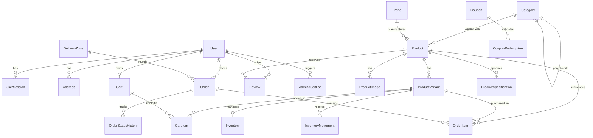

# Database Design & Modeling

Database Engine: PostgreSQL 14+ / Neon Serverless Postgres
ORM: Prisma ORM with Client Generation

---

## 1. Entity-Relationship Overview

---

## 2. Key Design Decisions

### A. Uniform Variant-First Inventory
Even singular products (e.g., a single teak dining table) possess a **default variant**.
- Inventory (`availableQuantity`, `reservedQuantity`, `lowStockThreshold`) is tied to the `ProductVariant` record, never directly to the abstract `Product`.
- This ensures carts and checkout routines always deal with a single immutable identifier: `variantId`.

### B. Dynamic Key-Value Specifications
- Rather than maintaining unwieldy categorical column matrices, `ProductSpecification` stores normalized key-value tuples grouped logically (`groupName`, `name`, `value`).
- Furniture specs: `{"Dimensions": "78 x 36 x 32 in", "Material": "Solid Sheesham Wood", "Upholstery": "Velvet"}`
- Electronics specs: `{"Energy Rating": "5 Star", "Capacity": "340 Litres", "Inverter Technology": "Yes"}`

### C. Historical Immutability
- Orders snapshot product details (`productName`, `variantName`, `sku`, `unitPrice`) inside `OrderItem`.
- The customer delivery address is snapshotted as a JSON object inside `Order.deliveryAddress`. Updating a saved profile address never alters prior orders or invoices.

### D. Audit Logging & State History
- `InventoryMovement`: Records all fluctuations (`PURCHASE`, `SALE`, `RETURN`, `ADJUSTMENT`, `DAMAGE`, `RESTOCK`) with reason and reference IDs.
- `OrderStatusHistory`: Every order lifecycle transition records the old status, new status, actor, and timestamp.
- `AdminAuditLog`: Records administrative adjustments to catalogue and settings.

---

## 3. Indexing Strategy

| Table | Index Columns | Purpose |
|---|---|---|
| `User` | `role, status` | Fast role-based filtering and security checks |
| `User` | `phone` (unique), `email` (unique) | O(1) user identification during login/checkout |
| `Product` | `categoryId, status` | Category-specific product browsing |
| `Product` | `status, isFeatured` | Rapid home page featured product lookups |
| `Product` | `slug` (unique) | SEO-friendly URL resolution |
| `Order` | `status, createdAt` | Dashboard queries and dispatch queues |
| `Order` | `customerId, createdAt` | Customer order history pagination |
| `Order` | `customerPhone` | Admin search for COD orders by phone number |
| `InventoryMovement` | `variantId, createdAt` | Stock audit trail lookups |
| `Address` | `pincode` | Local delivery zone grouping |
