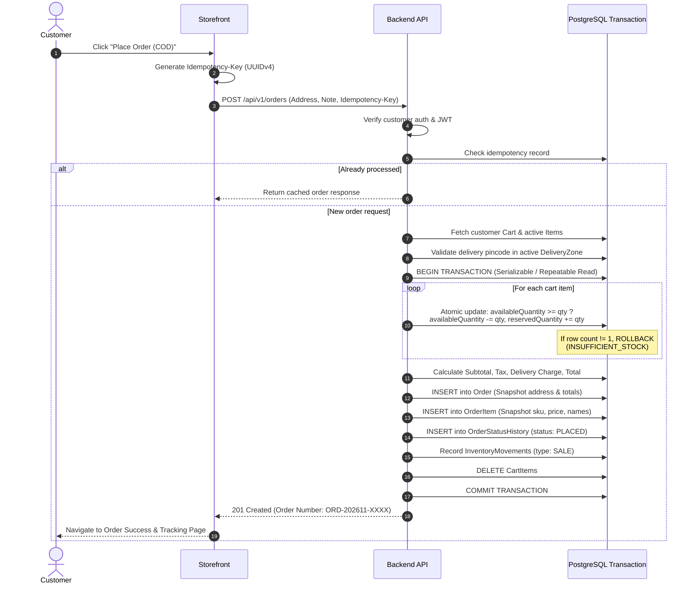
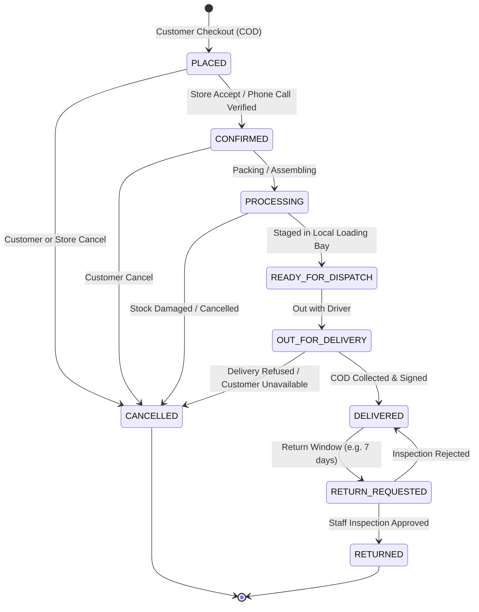

# Order Fulfillment & Checkout Flow

Detailed sequence diagram and transactional lifecycle for customer checkout and fulfillment.

---

## 1. Checkout Sequence Diagram

---

## 2. Order Status Lifecycle

---

## 3. Stock State Table Across Order Lifecycle

| Stage | Available Qty | Reserved Qty | Sold / In Possession | Inventory Movement |
|---|---|---|---|---|
| Initial Stock | 10 | 0 | 0 | None |
| Order Placed (2 items) | 8 (-2) | 2 (+2) | 0 | None (Reserved) |
| Order Cancelled | 10 (+2) | 0 (-2) | 0 | Movement: `RESTOCK` |
| Order Delivered | 8 | 0 (-2) | 2 (+2) | Movement: `SALE` |
