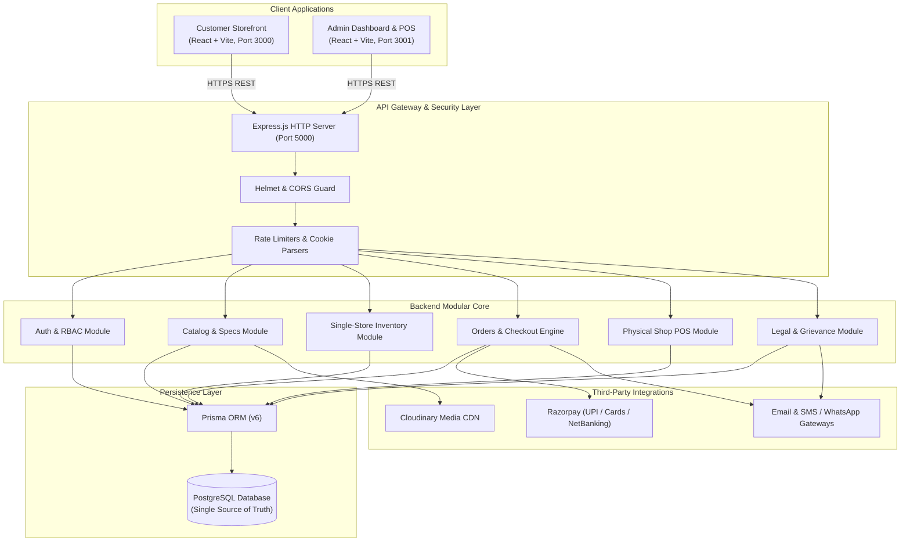

# Architecture & System Design Document
## Single-Owner Furniture, Electronics & Mobile Retail Platform

### 1. Architectural Style & Tenets

This platform follows a **Modular Monolith** architecture backed by a single relational PostgreSQL database.

### 2. Core Architectural Decisions (ADRs)

1. **Strict Monorepo with NPM Workspaces**:
   - `frontend/storefront`, `frontend/admin-dashboard`, and `backend` reside in the same git repository for unified versioning, but maintain independent `package.json` files and independent build lifecycles.
   - Zero Docker requirement. Zero pnpm or Yarn requirement.
2. **Independent Frontend Applications**:
   - Storefront and Admin are completely segregated web applications.
   - Storefront bundles never contain administrative routes, forms, or role guards.
3. **Unified Single-Store Inventory**:
   - Both physical counter billing (Shop POS) and customer website orders mutate the identical `Inventory` records inside transactional boundaries (`prisma.$transaction`).
   - Prevents overselling and provides realistic real-time stock levels.
4. **Dynamic Specification Engine**:
   - Instead of sparse column bloat across furniture, electronics, and mobile phones, specifications are modeled via `ProductAttribute` and `ProductAttributeValue`.
5. **Exact Decimal Monetary Arithmetic**:
   - Financial attributes (`mrp`, `sellingPrice`, `gstAmount`, `discountAmount`, `totalAmount`) utilize PostgreSQL `DECIMAL(12,2)` rather than IEEE floating-point numbers.
