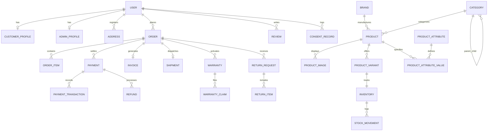

# Database Design & Entity Relationship Guide
## Single-Owner Retail E-Commerce Database

### 1. Database Architecture Principles

- **Engine**: PostgreSQL with Prisma ORM.
- **Normalization**: 3NF with dedicated snapshot preservation for completed orders (`OrderItem.titleSnapshot`, `OrderItem.skuSnapshot`, `OrderItem.unitPrice`, `OrderItem.gstRate`).
- **Precision**: `Decimal(12, 2)` for currency calculations to completely eliminate roundoff errors.

---

### 2. Entity Relationship Overview

---

### 3. Key Model Definitions & Data Domains

1. **Authentication & Identity**:
   - `User`, `CustomerProfile`, `AdminProfile`, `Address`, `Session`.
   - Supports role-based access control (`SUPER_ADMIN`, `ADMIN`, `STORE_MANAGER`, `CASHIER`, `DELIVERY_STAFF`, `CUSTOMER`).
2. **Product Catalog & Dynamic Attributes**:
   - `Category`, `Brand`, `Product`, `ProductImage`, `ProductVariant`, `ProductAttribute`, `ProductAttributeValue`.
   - Accommodates Furniture (dimensions, upholstery, wood finish), Electronics (energy star rating, screen size, resolution), and Mobiles (RAM, storage, camera specs, battery) without altering schema tables.
3. **Inventory & Shop Stock**:
   - `Inventory`, `StockMovement`, `Supplier`, `PurchaseEntry`.
   - Tracks `availableStock`, `reservedStock`, and `damagedStock` with historical movement audit trails.
4. **Orders, POS & Payments**:
   - `Order`, `OrderItem`, `OrderStatusHistory`, `Payment`, `PaymentTransaction`, `Refund`, `Invoice`.
   - Handles `OrderChannel.ONLINE_WEBSITE` and `OrderChannel.PHYSICAL_SHOP_COUNTER`.
5. **Fulfillment, Warranty & Returns**:
   - `Shipment`, `Warranty`, `WarrantyClaim`, `ReturnRequest`, `ReturnItem`.
   - Preserves IMEI / Serial numbers for Electronics and Mobile Phones, and assembly status for Furniture.
6. **Regulatory Compliance (India)**:
   - `LegalDocument`, `ConsentRecord`, `Grievance`, `AuditLog`, `BusinessSettings`.
