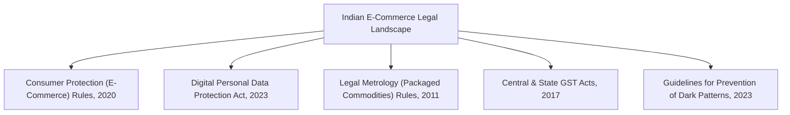

# Indian Legal & Regulatory Compliance Guide
## Single-Owner Retail E-Commerce (Furniture, Electronics & Mobiles)

### 1. Regulatory Framework Overview

This platform is structured around the statutory duties incumbent upon a **Single-Entity Retailer** operating its own digital storefront and physical shop in India:

---

### 2. Statutory Compliance Checkpoints

#### A. Consumer Protection (E-Commerce) Rules, 2020 & Applicable Amendments
1. **Mandatory Store Identity**:
   - Legal Entity Name, Principal Physical Address, GSTIN, Customer Support Phone, and Official Email must be prominently visible on the website footer, invoice, and contact pages.
2. **Grievance Officer Designation**:
   - Name, official email address, telephone contact, and designation of the Grievance Officer must be displayed.
   - Mechanism must acknowledge complaints within **48 hours** and provide redressal within **30 days**.
3. **No Cancellation Penalties**:
   - Consumers cannot be charged cancellation fees unless the merchant bears equivalent costs upon unilateral cancellation.
4. **Transparent Pricing & Price Breakup**:
   - Total price with explicit delivery fees, postal charges, and applicable GST breakdown displayed *prior* to payment checkout.

#### B. Digital Personal Data Protection (DPDP) Act, 2023 & Rules 2025
1. **Clear Notice & Consent**:
   - Explicit consent notice captured via `ConsentRecord` table specifying the purpose of processing (Order fulfillment, SMS delivery status updates, customer service).
2. **Data Minimization & Account Deletion**:
   - Customer account profile provides self-service download and statutory right to erase personal data (subject to GST audit retention requirements).
3. **Parental Consent / Age Verification**:
   - Consent safeguards applied during registration.

#### C. Legal Metrology (Packaged Commodities) Rules, 2011
On every electronic gadget, appliance, mobile accessory, or packaged furniture piece:
1. **Country of Origin** explicitly rendered on product detail pages.
2. **Name and Address of the Manufacturer or Importer**.
3. **Net Quantity & Physical Dimensions** (Length x Width x Height in metric units for furniture).
4. **Maximum Retail Price (MRP)** inclusive of all taxes, with the actual selling price and discount clearly juxtaposed.

#### D. Central Goods and Services Tax (GST) Act, 2017
1. Standard B2C / B2B GST tax invoice containing:
   - Invoice serial number and date.
   - Supplier GSTIN, PAN, and registered address.
   - Buyer GSTIN (for B2B corporate billing).
   - 4 or 8-digit HSN code for each line item.
   - Taxable value, CGST rate and amount, SGST rate and amount, or IGST for inter-state delivery.

#### E. Dark Patterns Guidelines, 2023
- Strict prohibition of:
  - **False Urgency** ("Only 1 left!" when stock is plentiful).
  - **Basket Sneaking** (automatically adding delivery insurance or warranty add-ons without user interaction).
  - **Confirm Shaming** (guilt-inducing language on opt-outs).
  - **Forced Action** (compelling newsletter sign-ups to purchase products).
